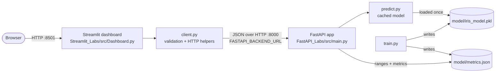
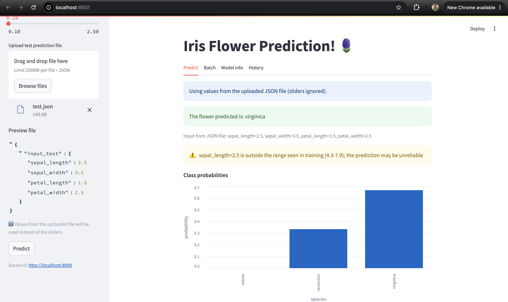
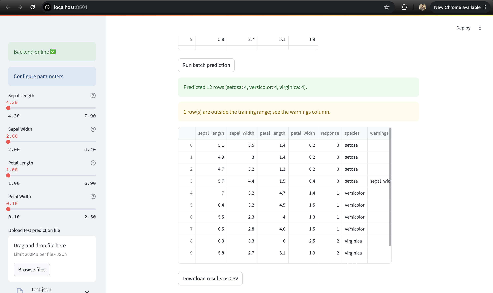
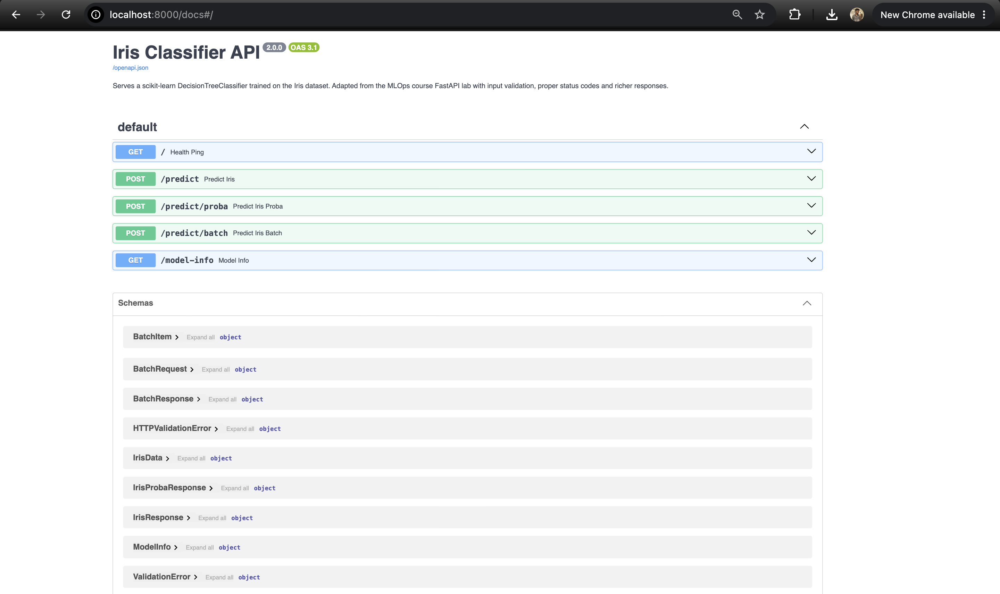
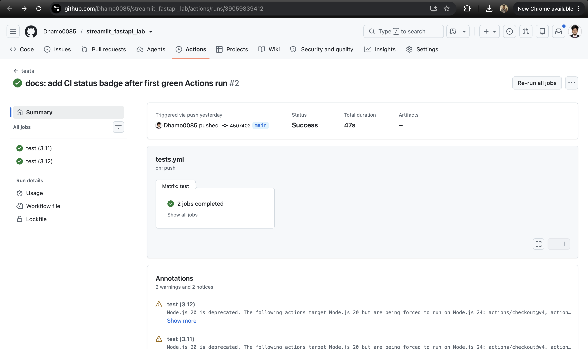

# streamlit_fastapi_lab


[](https://github.com/Dhamo0085/streamlit_fastapi_lab/actions/workflows/tests.yml)

This repo extends the **API_Labs** lab from Prof. Ramin Mohammadi's **MLOps course** (DADS 7305 / IE 7374, Northeastern University). The lab has two parts: the **FastAPI** backend, which serves an Iris Decision Tree, and the **Streamlit** dashboard that calls it. The original model, dataset, endpoints and dashboard widgets are all still here. On top of them I fixed 13 documented bugs and added:

- input validation, proper error codes, cached model loading, probabilities, batch prediction and a model-info endpoint;
- a tabbed dashboard with charts, CSV upload/download and prediction history;
- **227 tests** (the original had none) and GitHub Actions CI.

> **Submission:** this is a single submission of the course's **API_Labs** lab: the Streamlit dashboard (`Streamlit_Labs/`) plus the FastAPI backend it requires (`FastAPI_Labs/`).

Original labs: [raminmohammadi/MLOps → Labs/API_Labs](https://github.com/raminmohammadi/MLOps/tree/main/Labs/API_Labs) (`FastAPI_Labs/` and `Streamlit_Labs/`; `FLASK_GCP_LAB/` was not used).

---

## Contents

1. [Architecture](#1-architecture)
2. [Quick start](#2-quick-start)
3. [Verify the changes yourself](#3-verify-the-changes-yourself)
4. [What I changed](#4-what-i-changed)
5. [API reference](#5-api-reference)
6. [Validation rules](#6-validation-rules)
7. [Testing](#7-testing)
8. [Project structure](#8-project-structure)
9. [Screenshots](#9-screenshots)
10. [Design decisions and trade-offs](#10-design-decisions-and-trade-offs)
11. [Limitations and future work](#11-limitations-and-future-work)
12. [Credits and license](#12-credits-and-license)

---

## 1. Architecture



The dashboard never reads the model file. It only talks to the API, so the two halves can run on different machines.

---

## 2. Quick start

You need Python 3.11 or 3.12 (both tested locally on macOS: 3.11.10 and 3.12.14). Run all commands from the **repo root**.

### macOS / Linux

```bash
git clone https://github.com/Dhamo0085/streamlit_fastapi_lab.git
cd streamlit_fastapi_lab
python3 -m venv .venv
source .venv/bin/activate
pip install -r requirements.txt

# Optional: the trained model is committed, but you can re-train it
python FastAPI_Labs/src/train.py
```

**Terminal 1: backend (FastAPI on :8000)**

```bash
source .venv/bin/activate
uvicorn main:app --app-dir FastAPI_Labs/src --reload
```

**Terminal 2: dashboard (Streamlit on :8501)**

```bash
source .venv/bin/activate
streamlit run Streamlit_Labs/src/Dashboard.py
```

Then open <http://localhost:8501> (dashboard) and <http://localhost:8000/docs> (Swagger UI).

**Run the tests**

```bash
pytest -q
```

### Windows (PowerShell)

```powershell
git clone https://github.com/Dhamo0085/streamlit_fastapi_lab.git
cd streamlit_fastapi_lab
py -m venv .venv
.\.venv\Scripts\Activate.ps1
pip install -r requirements.txt
python FastAPI_Labs\src\train.py

# Terminal 1
uvicorn main:app --app-dir FastAPI_Labs/src --reload
# Terminal 2
streamlit run Streamlit_Labs/src/Dashboard.py
# Tests
pytest -q
```

> The Windows commands follow the same steps but were **not run on Windows**. Only macOS was tested.

### Options

| What | How |
|---|---|
| Original way of starting the API | `cd FastAPI_Labs/src` then `uvicorn main:app --reload` (still works) |
| Backend on another host/port | `export FASTAPI_BACKEND_URL=http://host:port` (PowerShell: `$env:FASTAPI_BACKEND_URL="http://host:port"`) before `streamlit run` |
| Only the end-to-end tests | `pytest -m integration` |
| Coverage report | `pytest --cov=FastAPI_Labs/src --cov=Streamlit_Labs/src --cov-report=term-missing` |

---

## 3. Verify the changes yourself

The first commit is the untouched original, copied byte-for-byte:
**[`c3c0feb`](https://github.com/Dhamo0085/streamlit_fastapi_lab/commit/c3c0feb) `baseline: original FastAPI and Streamlit labs (unmodified)`**

```bash
git diff c3c0feb..HEAD --stat   # every file changed since the original
git log --oneline               # one commit per improvement
```

| Commit | What it does |
|---|---|
| `c3c0feb` | baseline: original labs, unmodified |
| `61a8d6c` | fix(api): robust paths, cached model, validation, status codes (B1–B6) |
| `2a34abe` | feat(api): `/predict/proba`, `/predict/batch`, `/model-info`, extrapolation warnings |
| `49dcb31` | test(api): FastAPI test suite |
| `f43b0b4` | refactor(ui): testable `client.py`, fixes B7–B11 |
| `0a08ecb` | fix(api): warning text formats bounds as `2.0-4.1` |
| `508cab6` | feat(ui): tabs, probabilities, batch CSV, model info, history |
| `f3096ea` | test(ui): client, dashboard and integration tests |
| `266f6d7` | ci: requirements, pytest config, GitHub Actions |
| `e1df4f4` | docs: README, lab READMEs, captured evidence |
| *(latest)* | docs: CI status badge (added after the first green run) |

Raw command output that backs the numbers in this README is in [`docs/evidence/`](docs/evidence):
[`api_before.txt`](docs/evidence/api_before.txt) (the original API), [`api_after.txt`](docs/evidence/api_after.txt) (this version) and [`test_results.txt`](docs/evidence/test_results.txt) (pytest + coverage).

---

## 4. What I changed

### 4a. Kept from the original

**Nothing was removed.** All of the following still works exactly as before:

| Area | Kept as-is |
|---|---|
| Endpoints | `GET /` still returns `"status": "healthy"`; `POST /predict` still exists at the same path |
| Request schema | Same four fields (`sepal_length`, `sepal_width`, `petal_length`, `petal_width`), same `float` type. Numeric strings such as `"5.1"` are still converted, as the original README describes |
| Response schema | `response` is still an `int` (0/1/2). The original body returns `{"response": 0, …}` just like before (a test checks this) |
| Model | `DecisionTreeClassifier(max_depth=3, random_state=12)` |
| Data / split | Iris dataset, `train_test_split(test_size=0.3, random_state=12)`, so 105 train / 45 test |
| Python API | `load_data()`, `split_data(X, y)`, `fit_model(X_train, y_train)`, `predict_data(X)` keep their signatures and return types (new parameters are optional) |
| Scripts | `python train.py` from `src/`, and `uvicorn main:app --reload` from `src/` |
| Model file | `FastAPI_Labs/model/iris_model.pkl`. Re-training with scikit-learn 1.5.1 produces a **byte-identical** file |
| Dashboard sidebar | Page title/icon, backend status box ("Backend online ✅" / "Problem connecting 😭" / "Backend offline 😱"), "Configure parameters", the four sliders with the **same ranges, defaults and steps**, the JSON uploader with "Preview file" + `st.json`, the `IS_JSON_FILE_AVAILABLE` and `test_input_data` session-state keys, the **Predict** button |
| Dashboard output | "Predicting..." spinner, "The flower predicted is: …" success message, red error toasts, "Model not found. Run train.py" toast |
| Sample data | `Streamlit_Labs/data/test.json` (unchanged) |
| Pins | `scikit-learn==1.5.1`, `fastapi[all]==0.111.1`, `streamlit==1.37.0`. **No pin had to change**: a fresh venv installs and passes all tests on Python 3.11.10 and 3.12.14 |
| Docs | Both lab READMEs (tutorial text kept, only errors corrected) and all images in `assets/` |

**Behaviour that deliberately became stricter.** These inputs used to be accepted (see [`api_before.txt`](docs/evidence/api_before.txt)) and are now rejected with `422`: negative, zero or > 10 cm values, `NaN`/`Infinity`, booleans, and unknown extra fields. This is the bug fix B4, not a removed feature.

### 4b. Bugs fixed

| ID | Problem in original | Fix | Where |
|---|---|---|---|
| B1 | README said `uvicorn app:main --reload` | Corrected to `uvicorn main:app --reload` (plus the repo-root variant) | `FastAPI_Labs/README.md` |
| B2 | `"../model/iris_model.pkl"` is relative to the current directory, so `train.py` crashed and `/predict` returned 500 unless started from `src/` (evidence in `api_before.txt`) | Paths built from `Path(__file__).resolve()`; `fit_model()` takes an optional `model_path` | `train.py`, `predict.py` |
| B3 | Model loaded from disk on **every** request | Loaded once and cached (`functools.lru_cache`), eagerly at startup via FastAPI `lifespan`; `reset_model_cache()` for tests | `predict.py`, `main.py` |
| B4 | No range checks: `-5`, `NaN` and unknown fields all returned 200 with a prediction (evidence in `api_before.txt`); `true` was silently turned into `1.0` | `Field(gt=0, le=10, allow_inf_nan=False)`, `extra="forbid"`, booleans rejected; field names/types unchanged | `main.py` (`IrisData`) |
| B5 | Every failure became a generic 500 | Missing model → **503** with "run train.py"; truly unexpected errors → 500; `HTTPException`s are re-raised, not swallowed. NaN/Infinity can't turn a 422 into a 500 (a custom handler makes the echoed input valid JSON) | `main.py` |
| B6 | Response was a bare class number | Added `species` and `warnings` (additive) | `main.py` (`IrisResponse`) |
| B7 | `st.success("..." if ok else st.warning(...))` drew a stray warning **and** a green box | One box per state | `Dashboard.py` (`render_backend_status`) |
| B8 | The UI looked for `iris_model.pkl` in a sibling folder on the local disk | Asks the backend: `GET /` → `model_loaded` | `Dashboard.py`, `client.check_backend()` |
| B9 | Malformed JSON or a missing `input_test` key crashed the page | `parse_uploaded_json()` returns a readable error (line/column for bad JSON) and the page keeps working | `client.py`, `Dashboard.py` |
| B10 | `Streamlit_Labs/requirements.txt` was UTF-16 with CRLF line endings, which `pip install -r` often can't read | Re-encoded as UTF-8/LF with the same pins (plus `requests`, `pandas`); new root `requirements.txt` | `Streamlit_Labs/requirements.txt`, `requirements.txt` |
| B11 | Backend URL hard-coded to `http://localhost:8000` | `FASTAPI_BACKEND_URL` env var, same default | `client.get_backend_url()` |
| B12 | Streamlit README said `src/iris_model.pkl` (code: `model/`), used `streamlit run .\Dashboard.py` and a broken Windows activate path `.streamlitenv\Scripts\activate` | Corrected; cross-platform run command added | `Streamlit_Labs/README.md` |
| B13 | No tests, no CI | 227 tests (225 pass, 2 documented skips), GitHub Actions on Python 3.11 + 3.12 | `*/tests/`, `.github/workflows/tests.yml` |

### 4c. New features

| Area | Original | This version | Why it matters |
|---|---|---|---|
| Input validation | Type check only | Hard limits `0 < x <= 10`, finite, no extra fields, no booleans → 422 naming the bad field | Garbage no longer reaches the model or yields a confident-looking answer |
| Soft range warnings | — | Valid inputs outside the **training** range are accepted, and a `warnings` entry says the model is extrapolating | Users learn when the prediction may be unreliable, without being blocked |
| Status codes | Everything 500 | 422 / 503 / 500 as appropriate | Clients can tell "your input is wrong" from "server not ready" |
| Model loading | `joblib.load` per request | Loaded once at startup, cached | Faster, and a startup log says whether the model is present |
| Health check | `{"status": "healthy"}` | Adds `"model_loaded": true/false` | The dashboard (and ops) can see a missing model without calling `/predict` |
| Response | `{"response": 0}` | `{"response": 0, "species": "setosa", "warnings": []}` | Readable, backward compatible |
| Probabilities | — | `POST /predict/proba` (sums to 1, argmax = `/predict`) | Shows how confident the tree is |
| Batch | — | `POST /predict/batch` (1–100 samples; a 422 names the bad row) | Many predictions in one call |
| Model info | — | `GET /model-info`: type, depth, classes, features + metrics | Makes the served model inspectable |
| Training report | Saved the model only | Prints and saves `metrics.json`: test accuracy, 5-fold CV mean/std, confusion matrix, feature importances, training ranges, versions, timestamp | Evaluation is reproducible and visible |
| API docs | Bare `FastAPI()` | Title, description, version, example request in Swagger | `/docs` is self-explanatory |
| Logging | — | `logging` for startup, predictions and errors (no `print` in the API) | Debuggable in production |
| Dashboard layout | One page | Tabs: **Predict, Batch, Model info, History** | More features without clutter |
| Predict tab | Species text | Species + **probability bar chart** + extrapolation warnings + inputs used | Explains the prediction |
| JSON upload | Silent override, crash on bad file | Visible "sliders ignored" notice; friendly errors | No surprises, no crashes |
| Batch tab | — | CSV upload with column/value checks (row numbers), chunks of 100, results table, **Download results as CSV**, sample CSV | Practical bulk scoring |
| Model info tab | — | Accuracy, CV score, confusion matrix, feature-importance chart, training ranges | Model transparency in the UI |
| History tab | — | This session's predictions + **Clear history** | Compare several predictions |
| Backend URL | Hard-coded | `FASTAPI_BACKEND_URL` | Deploy the halves separately |
| Testable UI logic | Inside the page | `client.py`: pure functions with timeouts that never raise into the UI | 99% coverage on client logic |
| Tests | 0 | 227 (225 pass, 2 documented skips) | See [Testing](#7-testing) |
| CI | — | GitHub Actions: pytest + coverage on 3.11 and 3.12, then `train.py` from repo root | Every push is checked |

---

## 5. API reference

| Method | Path | Body | Success | Errors |
|---|---|---|---|---|
| GET | `/` | — | `{"status": "healthy", "model_loaded": bool}` | — |
| POST | `/predict` | 4 features | `response`, `species`, `warnings` | 422, 503, 500 |
| POST | `/predict/proba` | 4 features | + `probabilities` | 422, 503, 500 |
| POST | `/predict/batch` | `{"samples": [ … 1–100 … ]}` | `count`, `predictions[]` with `index` | 422, 503, 500 |
| GET | `/model-info` | — | model description + `metrics` (or `null`) | 503 |
| GET | `/docs` | — | Swagger UI | — |

The examples below are **real output** captured from the running server (`uvicorn main:app --app-dir FastAPI_Labs/src`) on 2026-10-17. The full transcript is in [`docs/evidence/api_after.txt`](docs/evidence/api_after.txt).

**Health**
```console
$ curl -s http://localhost:8000/
{"status":"healthy","model_loaded":true}
```

**Original request body (backward compatible)**
```console
$ curl -s -X POST http://localhost:8000/predict -H 'Content-Type: application/json' \
    -d '{"sepal_length": 5.1, "sepal_width": 3.5, "petal_length": 1.4, "petal_width": 0.2}'
{"response":0,"species":"setosa","warnings":[]}
```
(The original server answered `{"response":0}` for the same body.)

**Valid but outside the training range: accepted, with a warning**
```console
$ curl -s -X POST http://localhost:8000/predict -H 'Content-Type: application/json' \
    -d '{"sepal_length": 9.5, "sepal_width": 3.5, "petal_length": 1.4, "petal_width": 0.2}'
{"response":0,"species":"setosa","warnings":["sepal_length=9.5 is outside the range seen in training (4.3-7.9); the prediction may be unreliable"]}
```

**Probabilities**
```console
$ curl -s -X POST http://localhost:8000/predict/proba -H 'Content-Type: application/json' \
    -d '{"sepal_length": 6.0, "sepal_width": 2.7, "petal_length": 5.0, "petal_width": 1.6}'
{"response":2,"species":"virginica","probabilities":{"setosa":0.0,"versicolor":0.3333333333333333,"virginica":0.6666666666666666},"warnings":[]}
```

**Batch**
```console
$ curl -s -X POST http://localhost:8000/predict/batch -H 'Content-Type: application/json' \
    -d '{"samples": [{"sepal_length": 5.1, "sepal_width": 3.5, "petal_length": 1.4, "petal_width": 0.2},
                    {"sepal_length": 6.4, "sepal_width": 3.2, "petal_length": 4.5, "petal_width": 1.5},
                    {"sepal_length": 6.7, "sepal_width": 3.0, "petal_length": 5.2, "petal_width": 2.3}]}'
{"count":3,"predictions":[{"index":0,"response":0,"species":"setosa","warnings":[]},{"index":1,"response":1,"species":"versicolor","warnings":[]},{"index":2,"response":2,"species":"virginica","warnings":[]}]}
```

**Model info** (pretty-printed; arrays kept on one line)
```console
$ curl -s http://localhost:8000/model-info
{
  "model_type": "DecisionTreeClassifier",
  "max_depth": 3,
  "classes": ["setosa", "versicolor", "virginica"],
  "feature_names": ["sepal_length", "sepal_width", "petal_length", "petal_width"],
  "metrics_available": true,
  "metrics": {
    "model_type": "DecisionTreeClassifier",
    "params": {"max_depth": 3, "random_state": 12},
    "test_accuracy": 0.9556,
    "cv_folds": 5,
    "cv_accuracy_mean": 0.9429,
    "cv_accuracy_std": 0.0356,
    "confusion_matrix": [[20, 0, 0], [0, 12, 2], [0, 0, 11]],
    "target_names": ["setosa", "versicolor", "virginica"],
    "feature_names": ["sepal_length", "sepal_width", "petal_length", "petal_width"],
    "feature_importances": {"sepal_length": 0.0, "sepal_width": 0.0, "petal_length": 0.4553, "petal_width": 0.5447},
    "feature_ranges": {
      "sepal_length": {"min": 4.3, "max": 7.9},
      "sepal_width":  {"min": 2.0, "max": 4.1},
      "petal_length": {"min": 1.0, "max": 6.9},
      "petal_width":  {"min": 0.1, "max": 2.5}
    },
    "n_train": 105,
    "n_test": 45,
    "sklearn_version": "1.5.1",
    "trained_at": "2026-10-17T18:30:24+00:00"
  }
}
```

**Validation error (422)**: the original returned `200 {"response":0}` for this body.
```console
$ curl -s -w '\nHTTP %{http_code}\n' -X POST http://localhost:8000/predict -H 'Content-Type: application/json' \
    -d '{"sepal_length": -5, "sepal_width": 3.5, "petal_length": 1.4, "petal_width": 0.2}'
{"detail":[{"type":"greater_than","loc":["body","sepal_length"],"msg":"Input should be greater than 0","input":-5,"ctx":{"gt":0.0}}]}
HTTP 422
```

**NaN + unknown field (422, both problems reported)**
```console
$ curl -s -w '\nHTTP %{http_code}\n' -X POST http://localhost:8000/predict -H 'Content-Type: application/json' \
    -d '{"sepal_length": NaN, "sepal_width": 3.5, "petal_length": 1.4, "petal_width": 0.2, "color": "blue"}'
{"detail":[{"type":"finite_number","loc":["body","sepal_length"],"msg":"Input should be a finite number","input":"nan"},{"type":"extra_forbidden","loc":["body","color"],"msg":"Extra inputs are not permitted","input":"blue"}]}
HTTP 422
```

---

## 6. Validation rules

| Rule | Kind | Applies to | Result |
|---|---|---|---|
| All four fields present | **Hard** | every feature | 422 `missing` |
| Value is a number (numeric strings like `"5.1"` are converted, as in the original) | **Hard** | every feature | 422 `float_parsing` / `float_type` |
| Not a boolean (`true`/`false`) | **Hard** | every feature | 422 `value_error` |
| Finite (not `NaN`, `Infinity`, `1e400`) | **Hard** | every feature | 422 `finite_number` |
| `> 0` cm | **Hard** | every feature | 422 `greater_than` |
| `<= 10` cm | **Hard** | every feature | 422 `less_than_equal` |
| No unknown fields | **Hard** | request object | 422 `extra_forbidden` |
| 1 to 100 samples | **Hard** | `/predict/batch` | 422 `too_short` / `too_long` |
| Inside the training range (min–max of the 105 training rows) | **Soft** | `sepal_length` 4.3–7.9, `sepal_width` 2.0–4.1, `petal_length` 1.0–6.9, `petal_width` 0.1–2.5 | 200 + a `warnings` entry |

The dashboard checks the same hard limits before sending a request (`client.validate_payload`, `client.validate_batch_df`), and the API checks them again.

> Note: the training range is taken from the 70% training split, not the full dataset. The original Sepal Width slider goes up to 4.4, so slider values 4.2–4.4 correctly show a warning. The original `data/test.json` (`sepal_length` 2.5) also shows one.

---

## 7. Testing

**Original: 0 tests → Now: 227 tests (225 passed, 2 skipped)**, from 144 test functions, using `pytest.mark.parametrize`.

```text
======================== 225 passed, 2 skipped in 6.92s ========================
```

| Test file | Cases | What it covers |
|---|---:|---|
| `FastAPI_Labs/tests/test_api.py` | 90 | Health; **backward compatibility** with the original body; known species; 422 for 16 kinds of bad input plus NaN/±Infinity/1e400, empty and non-JSON bodies; 16 boundary values; soft warnings; 503 on all endpoints; 500 and HTTPException pass-through; proba; batch (1, 100, 101, empty, invalid item); model-info with/without metrics; 404/405; Swagger metadata |
| `FastAPI_Labs/tests/test_predict.py` | 18 | Output types, labels, probabilities, **model loaded exactly once**, cache reset, missing/corrupt model, metrics loading, range warnings, the **committed** `iris_model.pkl` loads and predicts |
| `FastAPI_Labs/tests/test_train.py` | 11 | Files written, metrics keys and values, original hyper-parameters, determinism, `train.py` run as a script **from another working directory** |
| `FastAPI_Labs/tests/test_data.py` | 7 | Shapes, 105/45 split, reproducibility, class/feature names |
| `Streamlit_Labs/tests/test_client.py` | 75 | Env-var URL, payload validation, JSON upload parsing (malformed, missing key, wrong types, BOM, non-UTF-8), CSV validation, error formatting, HTTP helpers with `requests` mocked (200/422/503/timeout/connection error/non-JSON), batch chunking |
| `Streamlit_Labs/tests/test_dashboard.py` | 17 (2 skipped) | `AppTest` smoke tests with the backend faked online/offline/erroring/model-missing; original sliders unchanged; predict flow, warnings, model-info tab, history clear, `FASTAPI_BACKEND_URL` |
| `Streamlit_Labs/tests/test_integration.py` | 9 | `@pytest.mark.integration`: client helpers → **real FastAPI app** (in-process `TestClient`) incl. `test.json` and `sample_batch.csv` round trips |

The model fixtures train a fresh model into a temporary directory, so tests never depend on or modify the committed model. One test checks the committed file on purpose.

**Coverage** (`pytest --cov=FastAPI_Labs/src --cov=Streamlit_Labs/src --cov-report=term-missing`, full output in [`test_results.txt`](docs/evidence/test_results.txt)):

| File | Stmts | Miss | Cover |
|---|---:|---:|---:|
| `FastAPI_Labs/src/data.py` | 14 | 0 | 100% |
| `FastAPI_Labs/src/main.py` | 132 | 0 | 100% |
| `FastAPI_Labs/src/predict.py` | 52 | 0 | 100% |
| `FastAPI_Labs/src/train.py` | 49 | 1 | 98% |
| `Streamlit_Labs/src/client.py` | 205 | 2 | 99% |
| `Streamlit_Labs/src/Dashboard.py` | 190 | 49 | 74% |
| **Total** | **642** | **52** | **92%** |

Non-UI code (everything except `Dashboard.py`) is at **99.3%** (3 of 452 statements missed). The one missed line in `train.py` is the `if __name__ == "__main__"` call. It does run, but in a subprocess, which coverage doesn't track.

**Intentionally not covered by automated tests**

- **File uploads in the dashboard.** `AppTest` in Streamlit 1.37 cannot drive `st.file_uploader`, so the two upload tests are explicit `skip`s with that reason. The logic behind them is fully tested in `test_client.py` and `test_integration.py`. The 49 missed `Dashboard.py` lines are these upload paths, plus one defensive check (lines 54–56) that only an invalid uploaded file could reach.
- **Visual rendering** (layout, colours, charts) beyond the AppTest smoke tests.
- **Manual check (done once, 2026-10-17):** in a real browser against the live backend I checked:
  - the malformed-JSON error and the `test.json` upload;
  - batch upload of `sample_batch.csv` (12 rows: 4 setosa / 4 versicolor / 4 virginica, 1 range warning);
  - CSV errors for missing/extra columns, NaN, non-numeric and out-of-range values;
  - the Model info and History tabs, and the "Backend offline 😱" state after stopping uvicorn.

  I did not click the CSV *download* button.

**CI:** `.github/workflows/tests.yml` runs the same command on Python 3.11 and 3.12 for every push/PR to `main` (and on manual dispatch), then checks that `python FastAPI_Labs/src/train.py` works from the repo root. The [first run](https://github.com/Dhamo0085/streamlit_fastapi_lab/actions/runs/39059738219) passed on both versions with the same result as locally: 225 passed, 2 skipped, 92% coverage.

---

## 8. Project structure

```
streamlit_fastapi_lab/
├── .github/workflows/tests.yml      # CI: pytest + coverage on Python 3.11 and 3.12
├── .gitignore
├── pytest.ini                       # pythonpath for both labs, `integration` marker
├── requirements.txt                 # everything for both labs + tests (UTF-8)
├── README.md                        # this file
├── docs/
│   ├── evidence/                    # raw curl / pytest output quoted in this README
│   └── screenshots/                 # dashboard / Swagger / CI screenshots
├── FastAPI_Labs/
│   ├── README.md                    # original lab README (B1 fixed, note at top)
│   ├── requirements.txt             # original per-lab pins (unchanged)
│   ├── assets/                      # original images
│   ├── model/
│   │   ├── iris_model.pkl           # output of train.py
│   │   └── metrics.json             # NEW: written by train.py
│   ├── src/
│   │   ├── data.py                  # load_data, split_data (+ FEATURE_NAMES, TARGET_NAMES)
│   │   ├── train.py                 # fit_model, evaluate_model, save_metrics, main
│   │   ├── predict.py               # cached model, predict_data, predict_proba_data, range checks
│   │   └── main.py                  # FastAPI app
│   └── tests/                       # conftest.py, iris_samples.py, test_{data,train,predict,api}.py
└── Streamlit_Labs/
    ├── README.md                    # original lab README (B12 fixed, note at top)
    ├── requirements.txt             # re-encoded UTF-8 (B10)
    ├── assets/                      # original images
    ├── data/
    │   ├── test.json                # original sample (unchanged)
    │   └── sample_batch.csv         # NEW: 12 rows for the Batch tab
    ├── src/
    │   ├── client.py                # NEW: pure, testable helpers
    │   └── Dashboard.py             # Streamlit app
    └── tests/                       # conftest.py, dashboard_fakes.py, test_{client,dashboard,integration}.py
```

---

## 9. Screenshots

> Taken on 2026-10-18 from the running app (`uvicorn` + `streamlit run`) and the CI run for commit `4507402`.

| Dashboard: Predict tab | Dashboard: Batch tab |
|---|---|
|  |  |

| Swagger UI (`/docs`) | GitHub Actions run |
|---|---|
|  |  |

---

## 10. Design decisions and trade-offs

- **Hard limits reject, soft limits warn.** A sepal can't be −5 cm or 50 cm, so those are input errors (422). A 9.5 cm sepal is physically possible but bigger than anything in the training data. Rejecting it would be paternalistic, and silently accepting it hides that the tree is extrapolating, so it gets a warning instead. The 10 cm cap is a generous sanity bound, not a statistical one.
- **Numeric strings are still accepted.** The original README teaches that `"5.1"` is converted to `5.1`. Keeping that preserves original behaviour. Booleans are rejected because `true → 1.0` is never what a caller means.
- **Model loaded at startup and cached.** This removes per-request disk I/O (B3). The cache is keyed on the model path, so tests can point at a temporary model and call `reset_model_cache()`. If the model is missing, the app still starts, reports `model_loaded: false` and returns 503. That is more useful than crashing.
- **Logic moved into `client.py`.** Streamlit pages are hard to unit-test. Pure functions that return `ApiResult` / `UploadResult` / `BatchValidation` objects (instead of raising) are easy to test, and they guarantee the page never shows a traceback. The same helpers accept an `http` object, so the integration test can pass FastAPI's `TestClient` and run against the real app with no server.
- **Ask the backend, not the disk (B8).** The original only worked when both labs sat side by side on one machine. `GET /` now reports `model_loaded`.
- **Additive API changes only.** New fields and endpoints were added. Nothing was renamed, so any client of the original API keeps working.
- **Range warnings come from `metrics.json`, written by `train.py`.** Retraining updates the warnings automatically. If the file is missing, warnings are skipped and `/model-info` returns `metrics: null`.
- **Batches are capped at 100 per request; the dashboard splits larger CSVs into chunks.** This keeps the request size bounded while still handling bigger files.

---

## 11. Limitations and future work

- **One small model on one small dataset:** a depth-3 decision tree on 150 Iris rows. Probabilities from a shallow tree are coarse (often 0, ⅓, ⅔ or 1).
- **No authentication, rate limiting or HTTPS.** Not suitable for public deployment as-is.
- **History is per browser session only.** It is lost on refresh; there is no database.
- **The model is a pickle.** It must be loaded with a compatible scikit-learn (pinned to 1.5.1), and pickles should only be loaded from trusted sources.
- **Dashboard upload paths have no automated UI tests** (Streamlit 1.37 `AppTest` limitation). They were checked by hand once.
- **Windows commands were not run.** Only macOS (Python 3.11.10 and 3.12.14) was tested locally. CI uses Ubuntu.
- **Possible next steps:** Dockerfile + docker-compose for both services, model versioning (e.g. MLflow), persisting history, an `/predict/explain` endpoint that returns the decision path.

---

## 12. Credits and license

- The original labs come from Prof. **Ramin Mohammadi**'s MLOps course at Northeastern University ([raminmohammadi/MLOps](https://github.com/raminmohammadi/MLOps), CC0-1.0). The tutorial text and images in `FastAPI_Labs/README.md`, `Streamlit_Labs/README.md` and the `assets/` folders are theirs.
- Adapted and extended by **Dhamodaran Selvam** ([@Dhamo0085](https://github.com/Dhamo0085)) as a course lab assignment.
- Iris dataset: R. A. Fisher (1936), via `sklearn.datasets.load_iris`.
